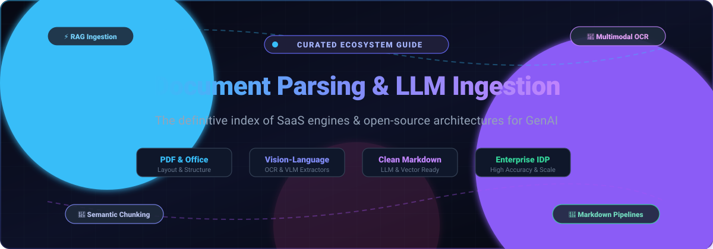

  

# 📑 Awesome Document Parsing & LLM Ingestion Engines 🚀

  
  
  
  
  
  

---

## 🎯 Overview & Scope

A curated directory and engineering guide tracking notable **SaaS/hosted platforms** and **open-source engines** for **Document Parsing, Multimodal Extraction, and LLM Ingestion**.

Whether transforming unstructured enterprise documents (PDF, DOCX, PPTX, XLSX, HTML, images, scanned records) into layout-preserving Markdown, JSON, or semantically chunked vector embeddings, this list compares available tools by performance, pricing tiers, free quotas, ecosystem maturity, and developer capabilities.

### 🔍 Key Capabilities Evaluated
- 📄 **Layout-Aware PDF & Office Parsers**: Preserving tables, nested headers, footnotes, and reading flow.
- 👁️ **Vision-Language Model (VLM) & Multimodal OCR**: Linearizing complex multi-column scientific and scanned documents.
- 🧩 **Structure & Semantic Chunking**: Generating clean token-bounded context blocks for RAG architectures.
- ⚡ **High-Throughput ETL & Ingestion**: Connecting cloud buckets, enterprise stores, and vector databases at scale.

---

## 📑 Table of Contents

- [📊 Sector Overview & Market Dynamics](#-sector-overview--market-dynamics)
- [☁️ SaaS / Hosted Document Ingestion Platforms](#️-saas--hosted-document-ingestion-platforms)
- [💻 Open-Source GitHub Projects](#-open-source-github-projects)
- [🛠️ Recommended Architecture Combinations](#️-recommended-architecture-combinations)
- [📈 Star History](#--star-history)
- [🤝 How to Contribute](#-how-to-contribute)
- [💖 Support & Sponsorship](#-support--sponsorship)
- [⚖️ Disclaimer](#️-disclaimer)

---

## 📊 Sector Overview & Market Dynamics

The Intelligent Document Processing (IDP) and LLM Document Ingestion sector represents an estimated global market size of **$2.5 billion in 2024–2025, projected to surge past $12 billion by 2030 (at an estimated CAGR exceeding 30%)**, heavily accelerated by enterprise GenAI, agentic workflows, and multimodal Retrieval-Augmented Generation (RAG) deployments.

The market displays a **moderately fragmented structure rather than a winner-take-all monopoly**:
1. **Hyperscale Cloud Providers** (Microsoft, Google Cloud, AWS) dominate high-volume commodity optical character recognition (OCR) and baseline form recognition through bundled enterprise agreements.
2. **GenAI-Native Ingestion Engines & Startups** (such as LlamaParse and Unstructured) capture fast-growing market share by offering semantic chunking, layout-to-Markdown distillation, and direct vector database connectors that legacy cloud OCR pipelines lack.
3. **Specialized Vertical IDP Vendors** (Hyperscience, Rossum, Docsumo, Nanonets) maintain robust market power in regulated, high-precision back-office domains (banking, mortgage underwriting, trade logistics, and automated accounts payable).
4. **Vibrant Open-Source Ecosystem** (Docling, MarkItDown, PaddleOCR, MinerU) serves as an alternative for privacy-conscious enterprise deployments requiring on-premise, zero-data-egress execution.

---

## ☁️ SaaS / Hosted Document Ingestion Platforms

The table below catalogs leading hosted and managed document extraction and LLM ingestion engines. 

> Sorted in descending order by estimated company valuation / annual parent revenue.

| Product | Company / Parent | Valuation / Revenue Scale | Starting Paid Tier Pricing | Free Tier / Free Trial Limits | Target Use Cases & Specialization |
| :--- | :--- | :--- | :--- | :--- | :--- |
| **[Azure AI Document Intelligence](https://azure.microsoft.com/en-us/products/ai-services/ai-document-intelligence)** | Microsoft | **~$3.1 Trillion** (Parent MCap / ~$245B+ ARR) | Pay-as-you-go: **$1.50 per 1,000 pages** (Read/Markdown Layout); prebuilt models from **$10.00 / 1,000 pages** | **500 pages/month free** under F0 (Free) tier | Enterprise cloud document ingestion with specialized Markdown layout model for LLMs, invoices, receipts, and identity documents. |
| **[Google Cloud Document AI](https://cloud.google.com/document-ai)** | Alphabet / Google | **~$2.1 Trillion** (Parent MCap / ~$350B+ ARR) | Pay-as-you-go: **$1.50 per 1,000 pages** (Document OCR); specialized parsers at **$30.00 / 1,000 pages** | **$300 free trial credits** for new accounts (valid for 90 days); first **1,000 pages/month free** for select basic extractors | Scalable Google Cloud ecosystem parser with intelligent layout parsing, table extraction, and native Vertex AI RAG integration. |
| **[AWS Textract](https://aws.amazon.com/textract/)** | Amazon Web Services | **~$2.0 Trillion** (Parent MCap / ~$105B+ AWS ARR) | Pay-as-you-go: **$1.50 per 1,000 pages** (Detect Document Text); **$15.00 / 1,000 pages** (Tables); **$50.00 / 1,000 pages** (Forms) | AWS Free Tier: **1,000 pages/month free** for Detect Document Text API for the first **3 months (90 days)** | High-throughput cloud-native OCR, tabular extraction, and key-value pair mining tightly integrated with Amazon S3 and Bedrock. |
| **[Hyperscience](https://hyperscience.com)** | Hyperscience | **~$1.6 Billion** valuation (backed by Tiger Global, Bessemer) | Enterprise contract pricing starting at **~$30,000 - $50,000 / year** based on volume commitments | **14-day assisted enterprise pilot / trial sandbox** available upon sales demonstration | Heavyweight enterprise hyperautomation & IDP platform handling highly distorted, handwritten, complex medical, legal, and financial docs. |
| **[Unstructured.io](https://unstructured.io)** | Unstructured Technologies | **~$200 Million** valuation ($40M Series B; ~$10M ARR run-rate) | Pay-as-you-go starting at **$1.00 per 1,000 pages** (Core Ingestion) or **$99.00 / month** Starter plan | **Free forever plan: 1,000 pages/month** free via API; plus a **14-day free trial with $250 API credits** for enterprise evaluation | Production ETL pipelines transforming unstructured docs from SharePoint, S3, and Confluence into vector-ready chunks. |
| **[Rossum](https://rossum.ai)** | Rossum | **~$120 Million** valuation ($100M Series A; ~$15M ARR run-rate) | Starter tier starting at **$1,500 / month** (billed annually) for transactional workflows | **14-day free trial** with full platform capabilities and sample document processing credits | Specialized transactional document AI platform for accounts payable, supply chain POs, invoices, with built-in human-in-the-loop review. |
| **[LlamaParse (LlamaCloud)](https://cloud.llamaindex.ai)** | LlamaIndex | **~$100 Million** valuation ($8.5M Seed + Series A led by Greylock) | Pay-as-you-go: **$0.003 per page** (~$3.00 per 1,000 pages) beyond daily free quota | **Free forever tier: 1,000 pages/day** (up to ~30,000 pages/month) for registered developers | GenAI-native document parsing engineered specifically to produce clean, layout-preserving Markdown and JSON for RAG. |
| **[Nanonets](https://nanonets.com)** | Nanonets | **~$80 Million** valuation ($29M Series B led by Accel; ~$10M ARR) | Pay-as-you-go: **$0.30 per page** (~$300 / 1,000 pages) for pay-per-use; Pro tier starts at **$499 / month** | **Free forever tier: 500 pages total** on signup; plus **7-day free trial** of automated workflow features | Automated document workflow platform with custom zero-shot model training, tabular validation, and direct ERP/database synchronization. |
| **[Docsumo](https://docsumo.com)** | Docsumo | **~$30 Million** valuation ($3.5M Seed; ~$4M ARR run-rate) | Growth tier starting at **$500 / month** (includes ~1,000 documents/month) | **14-day free trial** with access to pre-trained models and up to **100 document credits** | Document intelligence API for financial institutions, converting bank statements, pay stubs, and IRS tax forms into structured data. |
| **[Klippa DocHorizon](https://www.klippa.com/en/dochorizon/)** | Klippa | **~$25 Million** valuation (Bootstrapped / ~$5M+ ARR) | Pay-per-use starting at **€0.10 - €0.15 per document** (~€100 / 1,000 docs) or **€250 / month** subscription | **30-day free developer trial** with API sandbox access and **100 test document credits** | European cloud IDP suite with automated document classification, OCR, fraud detection, and strict GDPR/EU-compliant data handling. |

---

## 💻 Open-Source GitHub Projects

The table below catalogs notable open-source document parsing libraries, multimodal OCR engines, text splitters, and data extraction toolkits.

> Sorted in descending order by current GitHub star count. Each badge links directly to the repository's stargazers page.

| Repository | GitHub Stars | Primary Language / Ecosystem | Core Capabilities & Architecture |
| :--- | :--- | :--- | :--- |
| **[mendableai/firecrawl](https://github.com/mendableai/firecrawl)** |  | TypeScript / Python | Open-source web-to-Markdown engine turning dynamic websites, PDFs, and sitemaps into clean, LLM-ready context. |
| **[microsoft/markitdown](https://github.com/microsoft/markitdown)** |  | Python | Microsoft's multi-format parser converting PDF, Word, PowerPoint, Excel, audio EXIF/transcripts, and HTML into Markdown. |
| **[PaddlePaddle/PaddleOCR](https://github.com/PaddlePaddle/PaddleOCR)** |  | Python / C++ | Multilingual OCR and `PP-Structure` layout analysis engine extracting text, bounding boxes, and HTML tables from noisy scans. |
| **[unclecode/crawl4ai](https://github.com/unclecode/crawl4ai)** |  | Python | Fast asynchronous web scraping, layout cleaning, and Markdown extraction engine built specifically for LLM training and RAG. |
| **[opendatalab/MinerU](https://github.com/opendatalab/MinerU)** |  | Python | End-to-end scientific/academic document extractor (`Magic-PDF`) preserving equations, formulas, tables, and reading order. |
| **[docling-project/docling](https://github.com/docling-project/docling)** |  | Python | IBM Research-incubated parsing toolkit converting PDF, DOCX, PPTX, XLSX, HTML, and images into structured Markdown/JSON. |
| **[run-llama/llama_index](https://github.com/run-llama/llama_index)** |  | Python / TypeScript | Enterprise AI data framework providing extensive document readers (`LlamaHub`), transformation pipelines, and RAG orchestrators. |
| **[VikParuchuri/marker](https://github.com/VikParuchuri/marker)** |  | Python | Deep-learning pipeline converting complex PDFs, EPUBs, and book layouts into clean Markdown with LaTeX math formulas. |
| **[deepset-ai/haystack](https://github.com/deepset-ai/haystack)** |  | Python | Modular enterprise LLM orchestration framework offering document preprocessors, semantic cleaners, and search pipelines. |
| **[VikParuchuri/surya](https://github.com/VikParuchuri/surya)** |  | Python | Multilingual document OCR, reading order detection, layout analysis, and tabular recognition across 90+ languages. |
| **[allenai/olmocr](https://github.com/allenai/olmocr)** |  | Python | Allen Institute for AI's Vision-Language Model pipeline linearizing complex academic PDFs into natural reading order for LLMs. |
| **[Unstructured-IO/unstructured](https://github.com/Unstructured-IO/unstructured)** |  | Python | The open-source standard for document partitioning, metadata tagging, and chunking across dozens of file formats. |
| **[run-llama/liteparse](https://github.com/run-llama/liteparse)** |  | Python | Lightweight, fast document parser from LlamaIndex designed for efficient local PDF ingestion without heavy dependencies. |
| **[cocoindex-io/cocoindex](https://github.com/cocoindex-io/cocoindex)** |  | Rust / Python | Ultra-fast incremental data transformation and indexing engine keeping vector embeddings updated in real time. |
| **[pymupdf/PyMuPDF](https://github.com/pymupdf/PyMuPDF)** |  | C / C++ / Python | High-speed C-powered engine featuring `PyMuPDF4LLM` for CPU-efficient extraction of PDFs into GitHub-flavored Markdown. |
| **[py-pdf/pypdf](https://github.com/py-pdf/pypdf)** |  | Python | Pure-Python PDF library capable of extracting text, splitting, merging, cropping, and transforming pages with zero dependencies. |
| **[Goldziher/kreuzberg](https://github.com/Goldziher/kreuzberg)** |  | Rust / Python | Fast document intelligence engine written in Rust with Python bindings, featuring async parsing, OCR, and table extraction. |
| **[QuivrHQ/MegaParse](https://github.com/QuivrHQ/MegaParse)** |  | Python | Multimodal document parser optimized for zero information loss across PDFs, presentations, spreadsheets, and scanned docs. |
| **[pdfminer/pdfminer.six](https://github.com/pdfminer/pdfminer.six)** |  | Python | Community-maintained Python PDF parser focusing on exact character positioning, font analysis, and layout reconstruction. |
| **[pdfme/pdfme](https://github.com/pdfme/pdfme)** |  | TypeScript | TypeScript-first visual PDF generation and schema-based document transformation library for web and Node.js runtimes. |
| **[chonkie-inc/chonkie](https://github.com/chonkie-inc/chonkie)** |  | Python | Ultra-fast, lightweight chunking library supporting token, sentence, recursive, semantic, and late-chunking strategies for RAG. |
| **[apache/tika](https://github.com/apache/tika)** |  | Java | Enterprise-grade content analysis toolkit detecting and extracting text and metadata from over 1,400 distinct file types. |
| **[nlpaueb/edgar-crawler](https://github.com/nlpaueb/edgar-crawler)** |  | Python | Specialized finance scraper & parser extracting annual 10-K, 10-Q, and 8-K filings from the SEC EDGAR system for LLM financial analysis. |
| **[DS4SD/docling-core](https://github.com/DS4SD/docling-core)** |  | Python | Foundational data types, abstract schema representations, and JSON converters powering the Docling document processing ecosystem. |

---

## 🛠️ Recommended Architecture Combinations

For teams building self-hosted production LLM pipelines, here are proven open-source blueprints:

1. **Lightweight Local Ingestion Pipeline**:
   - **Parser**: `run-llama/liteparse` or `microsoft/markitdown`
   - **Chunker**: `chonkie-inc/chonkie` (Semantic / Late Chunking)
   - **Vector Store**: Qdrant / Chroma / Milvus

2. **High-Accuracy Academic & Financial PDF Processing**:
   - **Parser**: `opendatalab/MinerU` or `VikParuchuri/marker`
   - **OCR & Layout Fallback**: `PaddlePaddle/PaddleOCR` or `VikParuchuri/surya`
   - **Orchestration**: `run-llama/llama_index` or `deepset-ai/haystack`

3. **Enterprise Multi-Format Unstructured Lakehouse**:
   - **Ingestion**: `Unstructured-IO/unstructured` + `apache/tika`
   - **Sync & Indexing**: `cocoindex-io/cocoindex`
   - **Web / HTML Ingestion**: `mendableai/firecrawl` or `unclecode/crawl4ai`

---

## 📈 Star History

---

## 🤝 How to Contribute

Contributions are welcome! Please follow these steps:

1. 🍴 Fork the repository.
2. 🌿 Create a feature branch (`git checkout -b feature/add-new-parser`).
3. 📝 Add your tool to `README.md` adhering to the tabular layout:
   - For **SaaS tools**: Provide exact starting tier pricing, free tier/trial limits, valuation/revenue scale, and target use case.
   - For **Open-source projects**: Provide GitHub repo link, shield star badge (`style=social&color=white`) linking to its stargazers page, language, and core capabilities.
4. 📬 Submit a Pull Request with a brief summary of the engine.

---

## 💖 Support & Sponsorship

If you find this curated ecosystem directory and architecture guide useful:
- ⭐ **Star this repository** to help others in the AI & RAG community discover it!
- 🍴 **Fork & Share** with your colleagues on [X/Twitter](https://twitter.com), [LinkedIn](https://linkedin.com), and Reddit.
- ☕ **Sponsor the Maintainer**: Support continuous research and open-source updates on the [GitHub Sponsor Dashboard](https://github.com/sponsors/ishandutta2007).

---

## ⚖️ Disclaimer

- This list is **community-curated** for educational, architectural, and evaluation purposes.
- All product names, logos, trademarks, and brands are property of their respective owners.
- Pricing, valuations, and free tier limits reflect public information and are subject to change by respective vendors.
- When ingesting sensitive, proprietary, or PII-laden corporate files, prioritize privacy-first self-hosted engines (`Docling`, `MarkItDown`, `MinerU`, `PaddleOCR`) with localized weights to avoid unauthorized external data transmission.

  <b>Built with ❤️ for AI Engineers, RAG Architects, and Data Teams worldwide.</b>

